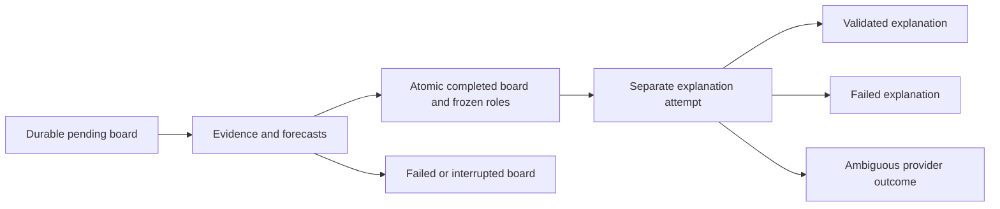

# Architecture for review remediation

This design implements the confirmed findings in the [review assessment](../research/2026-11-01-review-validation.md). It extends the existing SvelteKit application and `JournalStore`, preserves frozen records, and separates forecasting from explanation attempts. The companion [implementation plan](2026-11-01-review-remediation-implementation.md) defines the delivery sequence and acceptance checks.

Status: designed, application changes not implemented. Source baseline: `ee318d0`. This document supersedes neither the completed [October 29 plan](2026-10-29-correctness-architecture.md) nor existing ADRs. Proposed changes to their contracts are identified below. It authorizes no live migration, provider call, artifact replacement, deployment, or market release.

## Working checklist

- [x] Ground the design in source, glossary, journal specification, testing guidance, DESIGN, ADRs, and the validated review.
- [x] Compare two independent architectural candidates.
- [x] Synthesize ownership, caller usage, types, persistence, and verification requirements.
- [ ] Implement the increments in the companion plan.
- [ ] Pass application and disposable-database verification for the implemented behavior.

The requested deliverable is the architecture and executable implementation plan. Implementation boxes stay open until production code and its acceptance checks exist.

## Existing architecture and constraints

Routes parse form input and call `analysis/run.ts` or `analysis/board-run.ts`. Research analysis owns one offer and a policy conclusion. A board owns both sides of each entered market and code-computed model picks. Both collect evidence and call a constrained drafter. Private lean, actual bets, closing observations, and settlement notices remain separate records.

`JournalStore` combines `ResearchStore` and `GameBoardStore`. Memory implements those interfaces for browser acceptance. Neon adapts the SQL repository and board store. The public seam is useful, but its implementations disagree about backups. `JournalExport` currently belongs to `db/repository.ts`; the complete Neon store adds boards, while memory emits private arrays under the same version number.

Board orchestration already saves picks before drafting, but `finishBoard` assigns roles and completion after the explanation succeeds. Migration 012 makes terminal board rows immutable. Consequently, fixing draft-dependent eligibility requires giving explanation history its own persistence, rather than permitting further edits to terminal boards.

The database's unique primary indexes are necessary final guards. They do not serialize the first two completions because locking an empty set of role rows acquires no common row lock. Completion must serialize on the existing game row. Computation, evidence collection, and provider requests stay outside that transaction.

ADR 0003 requires market-anchored forecasts. ADR 0004 binds prospective evaluation to registered artifacts, completed primary observations, same-contract closes, and shared push mass. ADR 0005 makes authoritative report facts code-owned. The previous implementation plan also requires keeping the existing application and store seams. These decisions favor localized repairs over a replacement journal service or event store.

Historical facts remain as saved. A missing quote, unknown completion, or unrecorded contract cannot be reconstructed from the current schedule, model, or another record. Export remains version 1. Only `prospective-2026-10-26` can authorize release under the current project instructions. A proposed successor protocol is research until those instructions explicitly permit it.

## Caller usage

The following examples describe proposed interfaces. They are design sketches, not importable stubs. Existing domain types remain authoritative.

HTTP and CLI callers use the full journal for backup. They cannot select a partial SQL export by accident.

```ts
const backup = await journal.exportJournal();
const bytes = encodeJournalBackup(backup);
// HTTP returns bytes. CLI writes a new file without replacing an existing backup.

const result = await journal.restoreJournal(parseJournalBackup(uploadedBytes));
```

Analysis and board orchestration supply the same named inputs to the forecasting owner. The result contains the probabilities and uncertainty that will actually be saved and graded.

```ts
const pricing = selectMarketPrices(parseMarketQuotes(rawMarket));
const computed = await forecastMarket({
  game,
  cutoffAt,
  pricing,
  evidence: gathered.items,
});
```

A board completes when its computation completes. Explanation work starts only after that completion is durable.

```ts
const board = await journal.completeBoardForecast({
  boardId,
  evidence: gathered.items,
  gaps: gathered.gaps,
  markets: calculatedMarkets,
});

await explainFrozenBoard(board, { journal, drafter });
// Explanation failure changes explanation history, never board completion or pick roles.
```

Routes receive a typed rejection or a saved identifier. They do not choose primaries, pass SQL transactions, reconstruct anchors, or decide whether a provider request is safe to repeat.

Before `beginBoard`, the board workflow resolves and pins the forecasting artifact and selected registration for the entire submission. Preflight checks the actual artifact checksum, input-availability version, cutoff/registration chronology, protocol period, and entered markets. It returns a typed input rejection before creating a board when those inputs are incompatible. The store independently validates registration identity and immutable constraints at insertion. Expected registration errors are typed results, not uncaught exceptions from a call outside the workflow's error handling. Current valid registrations require all three markets, so subset-market rejection is a defensive boundary case rather than a normal selectable registration variant. A failure during real work after an attempt begins still leaves a durable readable failure.

## Module ownership

| Owner                                                                           | Knowledge and responsibility                                                                                                       |
| ------------------------------------------------------------------------------- | ---------------------------------------------------------------------------------------------------------------------------------- |
| New `src/lib/server/analysis/journal-backup.ts`                                 | Canonical v1 wire records, complete graph validation, legacy input normalization, deterministic encoding, and semantic equality.   |
| Existing `store.ts`, `neon-store.ts`, `neon-board-store.ts`, `db/repository.ts` | Storage adapters. The complete store owns export consistency and atomic restore. SQL collection readers remain internal.           |
| Existing `src/lib/domain/board.ts`                                              | Parsed anchor pair, exact contract matching, extra quotes, best-price selection, and quote provenance.                             |
| Existing `analysis/model.ts`                                                    | One evidence-aware forecast interface returning one frozen calculation.                                                            |
| Existing `analysis/model-pick.ts`                                               | Side selection and strength grade using frozen probabilities, anchor fair prices, and executable odds.                             |
| Existing `analysis/board-run.ts` and `board-store.ts`                           | Durable board workflow, atomic forecast completion, and separate explanation attempts.                                             |
| Existing `primary.ts` and `model-pick-primary.ts`                               | Pure classification rules, including parent exclusion. Storage owns synchronization and the authoritative completion clock.        |
| Existing provider transport and explanation validation                          | Persisted request intent and response accounting, bounded repair, typed fact references, visible failure, and no ambiguous replay. |
| New `src/lib/time.ts`                                                           | Explicit wall-time-to-instant conversion and input formatting in the declared entry zone.                                          |
| Existing routes and theme component                                             | Native form submission, action-specific results, field errors, accessible state, and saved-record presentation.                    |
| New `src/lib/server/access.ts` plus existing hook and launcher                  | Optional shared-secret sessions, server-wide access policy, and non-loopback startup validation.                                   |
| Existing source and model modules                                               | Declared play sample, bounded fetch, cache/training identities, versioned anchor algorithms, and release evidence.                 |

This keeps depth at the existing store and forecasting interfaces. A caller learns one backup operation and one forecast-completion operation, while the implementation hides graph relationships, locks, role assignment, and crash recovery. No generic command bus, repository registry, workflow engine, or event-replay system is introduced.

## Data shapes and pricing

Use discriminated variants for parsed markets. `HomeSpreadQuote`, for example, derives from the existing offer schema and constrains selection to `home` with a required line. Its parser proves the shared game, book, rules, mirrored lines, and observation instant for the pair.

```ts
type MarketQuotes =
  | {
      market: "moneyline";
      anchor: readonly [HomeQuote, AwayQuote];
      extras: readonly MoneylineQuote[];
    }
  | {
      market: "spread";
      anchor: readonly [HomeSpreadQuote, AwaySpreadQuote];
      extras: readonly SpreadQuote[];
    }
  | { market: "total"; anchor: readonly [OverQuote, UnderQuote]; extras: readonly TotalQuote[] };

type PricedMarket = {
  anchor: MarketQuotes;
  executable: readonly [Offer, Offer];
  comparisons: readonly BoardQuoteResult[];
};

function parseMarketQuotes(input: unknown): MarketQuotes;
function selectMarketPrices(input: MarketQuotes): PricedMarket;

type ForecastRequest = {
  game: ScheduledGame;
  cutoffAt: Instant;
  pricing: PricedMarket;
  evidence: readonly EvidenceItem[];
};

type ForecastResult =
  | { status: "unavailable"; reason: string }
  | { status: "computed"; sides: readonly [FrozenSide, FrozenSide] };
```

`Instant` and semantic identifiers are constructed by validating parsers. `FrozenSide` contains a `SavedForecast` and the policy-facing model projection derived from that same calculation. The implementation must not recompute a second, potentially different forecast for grading.

Selection follows these rules:

1. Compare the full contract: game, market, selection, that selection's point line, and rules. An away +3.5 quote matches away +3.5, not home -3.5.
2. Include the anchor price when ranking decimal odds. A worse extra quote cannot receive the best badge.
3. Prefer the anchor on equal prices. Break equal extra-price ties deterministically by sportsbook, observation time, and stable input order. Document whether all tied quotes receive a badge; the selected offer is always deterministic.
4. Preserve the chosen quote's actual sportsbook and observation time. Validate every quote against cutoff and kickoff.
5. Use only the anchor book's pair for de-vig and sportsbook margin. Use executable prices only for expected value and placed-contract comparisons.

New board markets explicitly persist their anchor pair with a pricing-format discriminator. Existing `offers` remain the executable offers so placed-bet and settlement callers retain their meaning. The reader never silently recomputes an old pick using new price-selection rules. Old anchor recovery uses only saved opposing quotes when they prove one consistent pair; otherwise the old anchor display remains unavailable.

Replace positional `ModelSource` and `ForecastSource` coordination with the named request in their current owner. Migrate all callers and remove the duplicate internal path in the same increment. The current fourth model argument is an anchor, so adding evidence positionally is not a valid fix.

For `/`, add the opposing quote throughout request types, parser, native form, error preservation, refresh, and snapshot capture. The selected and opposing prices must prove one same-book pair. Research with incomplete prices can still explain an unavailable forecast; it must not claim to have captured probabilities. A refresh preserves market and selection while collecting a complete new paired quote.

## Board completion and explanation history

New boards carry a lifecycle discriminator such as `forecast-first-v1`. An absent discriminator identifies the legacy lifecycle. It does not cause a migration to classify old failed boards.

`completeBoardForecast` replaces the public freeze-then-finish sequence for new boards. All entered markets resolve to a frozen pick or an explicit no-pick reason. The operation stores evidence, freezes markets and picks, assigns roles, and sets `status = completed` with `completedAt` in one transaction. A board with no computable picks can complete with its reasons and no explanation.

The existing prospective evaluator keeps requiring a completed board with proven pregame chronology. It does not gain a fallback accepting failed boards or pick creation timestamps. Future completed boards meet that predicate before drafting because all forecasting work is complete. A clarification ADR extends ADR 0005 to define this lifecycle; if implementation requires accepting a failed board or weakening chronology instead, it has departed from this design and must stop that activation.



Explanation history uses a small append-only table, not new statuses on `game_boards`.

```ts
type ExplanationEvent =
  | { kind: "started"; drafter: BoardDrafter }
  | { kind: "request-intent"; request: ProviderRequestIntent }
  | { kind: "response"; exchange: ProviderRequestRecord }
  | { kind: "validated"; report: PickExplanationReport }
  | { kind: "failed"; reasons: readonly string[] }
  | { kind: "ambiguous"; reason: string };

type ExplanationState =
  | { kind: "not-requested" }
  | { kind: "pending"; attemptId: ExplanationAttemptId }
  | { kind: "validated"; attemptId: ExplanationAttemptId; report: PickExplanationReport }
  | { kind: "failed"; attemptId: ExplanationAttemptId; reasons: readonly string[] }
  | { kind: "ambiguous"; attemptId: ExplanationAttemptId; reason: string }
  | { kind: "legacy"; report: PickExplanationReport | null; usage: RunUsage | null };

type BoardExplanationWrites = {
  beginBoardExplanation(input: BeginExplanation): Promise<BeginExplanationResult>;
  reserveBoardExplanationRequest(input: RequestIntent): Promise<RequestReservationResult>;
  recordBoardExplanationResponse(input: SavedExplanationResponse): Promise<ExplanationState>;
  finishBoardExplanation(input: ExplanationOutcome): Promise<ExplanationState>;
};
```

The event union describes private persistence. Callers use the named operations above rather than appending arbitrary events. The store assigns event order and recorded time. It validates transitions and immutable identity. A repeated event ID with equal content is idempotent; different content conflicts. One terminal event per attempt prevents two outcomes. The store serializes event append for the same board without holding any lock during a network request.

Beginning an explanation checks under that lock that the board has no other active explanation attempt. The initial automatic explanation uses a stable submission identity derived from its board and format. Each draft or repair phase has one request identity. `reserveBoardExplanationRequest` atomically records intent and returns either a newly acquired reservation, an existing state, or a conflict. Only the newly acquired reservation permits transport. Repeating the call returns no second send capability. The reservation stays private to the request executor. Do not expire a reservation and resend after a crash: the original request may already have incurred a charge.

The real provider boundary awaits a durable request-intent before each paid draft or repair request and stores each durable response before validation continues. A request-intent without a proven response is ambiguous after interruption, even if transport might never have sent it. Recovery never repeats that request automatically. A durable response can be validated without another request. Original and repair usage sum independently; missing accounting stays partial or unknown.

The read projection uses new explanation events only for new-lifecycle boards. Historical inline explanation/provider fields remain as saved. New writes to those inline fields are retired together with the old new-board finalization path. The UI renders independent statuses such as “Forecast frozen” and “Explanation failed.” A retry, if exposed, requires a deliberate new explanation attempt and never regenerates the pick.

## Completion concurrency and crash behavior

Use the following ordering for every analysis or board completion path, including compatibility writers:

1. Resolve the internal game identifier without taking a child-row lock.
2. Lock the shared `games` row with `FOR UPDATE`.
3. Lock the analysis or board row and re-read its state.
4. Return an identical existing completion unchanged. Reject a conflicting attempt to complete the same identifier.
5. Obtain completion time from the store clock after serialization. PostgreSQL uses a current clock value, not the transaction-start `now()` or the form's cutoff time.
6. Persist completion, frozen market facts, and role selection atomically. Keep the unique primary indexes.

Primary selection reads no result. It requires a completed pregame observation, proven completion chronology, and a non-refresh parent relationship. At most one primary exists per game for analyses and per game/market for model picks. Unknown historical completion remains unclassified. Memory performs selection and mutation without an awaited interleaving and uses its injected clock.

| Interruption point                                  | Durable result and permitted recovery                                                                                          |
| --------------------------------------------------- | ------------------------------------------------------------------------------------------------------------------------------ |
| Before forecast transaction commits                 | No partial completion or role assignment. The attempt remains readable.                                                        |
| After completion, before explanation starts         | Board and roles stay completed. Recovery reads them rather than recomputing picks.                                             |
| After paid-request intent, before durable response  | Explanation is ambiguous. Another paid request needs a deliberate new attempt.                                                 |
| After durable response, before validation           | Revalidate the saved response without another paid call.                                                                       |
| Explanation contradicts the pick or exhausts repair | Save visible explanation failure. Frozen numbers, selection, grade, and primary eligibility stay unchanged.                    |
| Two different submissions complete together         | Both remain readable; one becomes primary under game-row serialization and the other receives the applicable non-primary role. |

Network I/O never occurs inside a completion or restore transaction. Restore acquires shared game locks in sorted identity order where required, preventing reversed lock order across multi-game imports.

## Canonical backup and restore

Move the version 1 wire types and validation from SQL ownership to `journal-backup.ts`. Keep the established normalized collections and their public names. Both stores emit this shape. Add optional collections for new explanation events and explicitly versioned market/lifecycle metadata. Missing optional collections mean the established legacy default, not invented facts.

The codec owns:

- Parsing unknown JSON and rejecting unsupported versions or extension variants.
- Duplicate IDs, missing references, parent/correction cycles, same-subject corrections, frozen facts, chronology, and provider-history validation.
- Recognition of historical memory-v1 private fields and lossless conversion before writes.
- Semantic equality for objects regardless of key order, with array order preserved. Null and absence are equal only when the schema defines that equivalence.
- Deterministic serialization of collection order while preserving meaningful order inside saved payloads.

New exports never emit private `runs`, `actualBets`, `closingObservations`, or `notices` alternatives. Recognized old memory backups remain input-compatible. If normalized and private data coexist, require semantic agreement after normalization or reject the file. Never choose whichever representation is easiest and discard the other.

Memory must retain technical IDs for normalized game, offer, and relationship records. Generate those IDs once when records are created. A legacy memory import that lacks a SQL surrogate uses a deterministic namespaced technical ID derived from its existing stable record identity. This creates storage identity only. It does not establish a source fact, contract, kickoff, or timestamp. Reject a legacy shape that cannot be represented without fabricating facts.

Export reads a coherent graph. Neon reads all collections, including boards, under one consistent read snapshot. Memory clones a consistent state. The CLI uses the same complete store operation and TLS connection policy as the application. Validate the graph before writing the backup. Write a new destination exclusively so a failed export cannot destroy an earlier backup.

Restore first validates the whole incoming graph, then checks destination identity conflicts and writes atomically. Memory stages replacement maps and swaps only after validation. Neon uses one transaction with this dependency order:

1. Protocol registrations and games.
2. Offers and evidence.
3. Analyses in parent-first order, reports, and private research.
4. Boards in parent-first order, markets, picks, roles, and explanation history.
5. Actual bets with their own recorded contracts.
6. Legacy settlements, all settlement-notice subjects, correction chains, and closings.
7. Closing market snapshots after their referenced records exist.

The exact order of independent collections can vary. Foreign-key predecessors and correction parents must exist first. Duplicate insert races must compare the winning stored record rather than overwrite it. Any conflict rolls back the complete import. Restoration never calls a provider, downloads evidence, or reclassifies a primary.

Settlement subjects become a parsed discriminated union behind the wire representation: analysis, actual bet, or game. Keep the current wire fields readable, including valid existing analysis/bet combinations. Validate their relationship explicitly rather than requiring `analysisId` for every notice.

## Additive migrations and rollout

Reserve the next available numbers after migration 024 at implementation time. Never modify the earlier migration files.

| Migration             | Contents and prerequisite                                                                                                                                                                                                                                                                            |
| --------------------- | ---------------------------------------------------------------------------------------------------------------------------------------------------------------------------------------------------------------------------------------------------------------------------------------------------- |
| Integrity protections | Append-only triggers on protocol registrations and closing market snapshots. Validate existing registration references and add a restrictive board-registration FK. Registration-first restore must ship with it.                                                                                    |
| Pricing metadata      | Nullable explicit anchor-pair and pricing-format fields on board markets. New writes require the new format and valid paired anchors. Existing rows keep legacy absence. Include quotes in every reader and restore writer.                                                                          |
| Explanation lifecycle | New-board lifecycle discriminator and append-only `board_explanation_events` with board/attempt identity, sequence, recorded time, versioned payload, unique event identity, unique request-phase reservations, and a unique terminal event per attempt. Keep terminal-board immutability unchanged. |

The migration checks invalid existing references and fails with identifiers. It must not delete a registration reference or fabricate its target. Database code validates event transitions and payload versions, while constraints enforce referential identity, ordering uniqueness, and append-only behavior. New artifact/release persistence, if later selected, gets its own migration and backup collection.

Rehearse migrations and restores against disposable PostgreSQL. Deployment uses only `npm run db:migrate` through a separately authorized operation. Once new-format records exist, a pre-change binary is not a safe write rollback. Keep the additive schema and use a compatible application revision or forward fix. No downgrade rewrites frozen rows.

## Runtime, forms, and access

`fetchBounded` applies one deadline to headers and complete body consumption, aborts transport, and rejects late body success. The existing malformed-JSON gap path remains in place. Do not implement a workaround for the disproven NWS exception claim.

Numeric explanation validation keeps code-owned fact references. Permit verified game/entity names and a controlled football vocabulary rather than removing number checks. Names and allowed terms come from trusted team metadata and the saved game/evidence context. Terms such as `49ers`, `QB1`, and `3rd down` do not create permission for arbitrary numerical claims. A week number used as a game fact must match the frozen game or use an authoritative reference. Prices, percentages, lines, and numeric evidence claims still require resolved references under ADR 0005.

Sanitize provider errors before persistence and again on display. Match exact configured secrets as well as recognized credential forms. Transport failures expose typed, bounded diagnostic information rather than arbitrary response bodies or request headers. Settings and credentials remain structurally absent from backups. If an otherwise immutable record contains a known secret, export rejects with record identifiers and a remediation explanation instead of silently changing that record's content. Explicit legacy remediation must preserve audit history and restore identity.

Each route action returns an action discriminator, outcome, and field errors. Only its corresponding form renders that result. Native input names are the submitted field names; no hidden parent-price copies or delayed imperative submit are needed. Preserve entered values on failure. Pending behavior must recover on browser back navigation.

Time entry names `America/New_York` explicitly. One helper parses wall time in that zone and formats defaults in that same zone, independently of the server's `TZ`. Reject nonexistent spring-forward times. An ambiguous fall-back time requires an explicit occurrence or offset. Saved ISO instants remain untouched.

Theme selection updates reactive local state and the existing cookie. Unknown markers have one rendering owner. Feature labels derive from authoritative feature definitions or an exhaustive typed mapping. Fix the primary button variant, ink hover semantics, and raw CSS gating. Verify 390px overflow and back-navigation behavior in a production browser before claiming those symptoms fixed.

LAN protection is a separate increment because the existing LAN mode is deliberately unauthenticated and documented that way. Keep loopback defaults. When protection is enabled, one server hook gates pages, SvelteKit data requests, downloads, and all actions before journal/provider access. A login exchanges a configured high-entropy server secret for a signed expiring HttpOnly, SameSite cookie. Never put the configured secret in the cookie, URL, backup, or logs. Use constant-time verification, bounded login attempts, expiry, and logout. Secure cookies apply under HTTPS. A cookie on plain HTTP does not provide network confidentiality, so document trusted-LAN HTTP limitations and HTTPS proxy behavior. Retain Host allowlisting and origin checks.

## Model changes and release identity

Correct PROE over the declared eligible non-null sample. Define offense and defense efficiency over a declared scrimmage sample, excluding special teams and intentional kneels/spikes. Garbage-time filtering, era normalization, non-QB injuries, weather interactions, and alternate de-vig methods remain separate hypotheses.

Aggregation changes bump summary-cache and training-code versions. A changed cache may never feed an artifact that expects the old feature semantics. Refit model and browser fixtures deliberately, update pinned fixture identities, and register the new artifact at the actual time before collecting its qualifying forecasts. Old forecasts remain frozen. Fix per-model ablation centering with a fixture whose means differ.

Probability-matched anchors are a separate model revision. Solve the same-book decisive probability against the final discrete outcome distribution, including key weights and explicit tie/push rules. Test achievable brackets, monotonicity, and probability residual tolerance. Return unavailable for an infeasible target. Do not apply a fixed median shift or assume every market should start at 50/50. Training, calibration, evaluation, and live freezing must use the same versioned mapping. Record a successor ADR to 0003 and refit before use.

Release must not mutate the registered predictive artifact. Prefer keeping its exact original checksum and writing a separate immutable release attestation bound to that checksum, the market, registration, and evidence identity. This is smaller and safer than excluding fields from the v6 checksum algorithm. Full-file checksums keep their original meaning. The attestation gets its own integrity checksum and contains or references a complete locally available source-evidence bundle. An imported release verdict is never authority: recompute qualification and the release gate from that bundle when verifying it. Cache verification by immutable artifact/evidence identity, not by an editable verdict flag.

This requires an ADR extending 0004's deployment representation and changing `valueEligibility` to consume verified release evidence separately from raw artifact metadata. Historical v6 release fields remain readable as saved. No old checksum, registration, or forecast is rebound. The app freezes prediction identity and the separate eligibility/attestation identity used at decision time.

Current prospective qualification retains same-book, same-line closes and shared push mass. Add descriptive push calibration and key-line diagnostics without changing that gate. A moved-line reference probability needs additional alternate quotes or an explicitly validated distribution model. Keep inferred reference prices separate from observed comparable closes. A successor evaluation protocol needs a frozen design, new registration, and explicit project-policy authorization before it can release a market.

## Queries and workflow improvements

Batch board, market, pick, withdrawal, and settlement reads by referenced identities. Avoid hydrating every completed analysis when no closing references it. Use primary-only lookup predicates where that is the actual query, then inspect representative plans before adding indexes. Query structure improvements are not a measured latency result.

Reporting keeps primary assessments, actual bets, and primary model picks in distinct cohorts. Show sample size, missing/unresolved counts, raw same-contract odds movement, and separately named two-sided no-vig metrics. Calibration uses saved probabilities and later notices. It does not rerun forecasts or claim a market has been released.

Schedule-assisted settlement prepares a draft from a sourced result with retrieval time and explicit confirmation. It appends notices through existing subject-specific settlement operations. It does not silently grade another contract or replace corrections. A correction selector names the earlier notice instead of requiring pasted IDs. Add stable cursor pagination and season/week grouping only after batched reads, preserving full export coverage.

Structured QB overrides are timestamped evidence with player identity, team, position, designation, and provenance. They are not private-lean text. Non-QB injury activation additionally requires usable publication times, snap coverage, a declared feature definition, chronological validation, refit, and new registration. Existing helper availability is not activation evidence.

## Synthesis decision and alternatives

Candidate A is the base because it retains `JournalStore`, repairs both adapters, and completes the board without changing the evaluator's completed-board predicate. Candidate B contributed the explicit crash matrix, strict legacy import rules, and separation of model corrections from prospective redesign.

The candidates were produced by independent agents using the available inherited model. The skill's default external runner families were unavailable. This is independent design exploration, not a claim of cross-model agreement. The independent comparison and final review are recorded with the implementation plan.

Reject a generalized event-sourced journal. Its replay, projection, and migration rules would make data-loss repair depend on replacing working bet and settlement storage. Reject a second public `JournalService` facade that forwards the same operations. Reject keeping board failure tied to drafting while adding a second completion predicate to every evaluator and performance query. Only explanation history needs an independent event sequence.

We accept per-game serialization because one primary is genuinely shared state. We accept input-only legacy backup adapters because historical data must remain recoverable. We accept a separate explanation table to preserve terminal-board immutability. We accept slower, fully validated release-evidence loading before any real release, with immutable-identity caching, rather than trusting editable output verdicts.

## Risks and unresolved activation decisions

Historical memory backups may lack a representable relationship. Such a file must fail explicitly rather than gain fabricated facts. Existing registration references may prevent FK validation and require a separately reviewed repair. The local-time implementation must prove DST handling with the installed date library before selecting its exact calls.

Optional explanation retry UI, LAN startup enforcement, pagination size, and experimental feature activation are scoped decisions for their own increments. They do not block persistence repairs. A new protocol remains inactive research under current release instructions.

The first implementation step is a mixed-record backup fixture with quotes, pick bets, bet-only correction notices, and interrupted provider history, then shared memory/Neon round-trip assertions against the canonical v1 interface.
